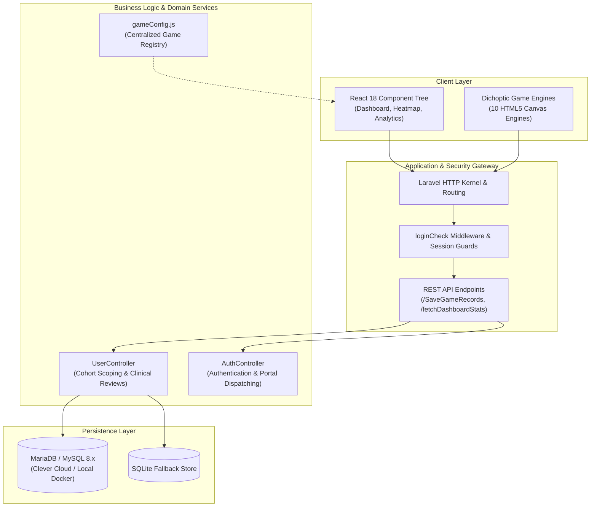

# 🏛️ LazyEye — Technical Architecture & Clinical Specification

> **A Full-Stack Digital Therapeutics Platform for Amblyopia Rehabilitation using Dichoptic Stimulation, Red-Cyan Anaglyph Rendering, and Role-Scoped Clinical Workspaces.**

---

## 1. Clinical Foundations & Dichoptic Mechanics

Amblyopia ("Lazy Eye") is a neuro-developmental disorder of binocular vision where the visual cortex suppresses input from one eye in favor of the fellow eye. Traditional occlusion therapy (patching the strong eye) enforces monocular training but fails to train binocular cortical fusion.

```mermaid
flowchart TD
    subgraph Traditional Occlusion
        T1["Strong Eye Patched"] --> T2["Weak Eye Trains Monocularly"]
        T2 --> T3["Zero Interocular Synchronization"]
    end

    subgraph Dichoptic Digital Therapy (LazyEye)
        D1["Both Eyes Open With Red/Cyan Glasses"] --> D2["Left Eye Sees Red-Channel Entities Only"]
        D1 --> D3["Right Eye Sees Cyan-Channel Entities Only"]
        D2 & D3 --> D4["Visual Cortex Forced to Combine Inputs"]
        D4 --> D5["Simultaneous Binocular Fusion & Stereopsis"]
    end
```

### Chromatic Channel Separation Mechanics
In LazyEye's HTML5 Canvas and React engines, gameplay entities are partitioned by chromatic wavelength:
- **Primary Game Target (Falling Tetromino / Snake Food)**: Rendered strictly in `#FF0000` (Red channel), visible only through the Red filter of the amblyopic eye.
- **Reference Frame (Grid Borders / Obstacles)**: Rendered in `#00FFFF` (Cyan channel), visible only through the Cyan filter of the fellow eye.
- **Dynamic Contrast Clamping**: Both channels support independent contrast calibration ($0 \dots 255$) managed by the supervising optometrist to accommodate patient-specific suppression depth.

---

## 2. High-Level System Architecture



---

## 3. Multi-Tier Role Jurisdiction & Scoping

The system enforces strict data isolation across 4 operational tiers:

| Role | Jurisdiction & Capabilities | Security Scoping |
| :--- | :--- | :--- |
| **👑 Root Superadmin** (`root`) | Multi-clinic database oversight, administrator provisioning, and infrastructure health metrics. | Global access to all clinic nodes. |
| **🏥 Clinic Administrator** (`admin`) | Patient intake verification, doctor credentialing, doctor-to-patient assignment, and clinic-wide compliance KPIs. | Scoped to clinic jurisdiction; cannot inspect other clinics' internal rosters. |
| **🩺 Doctor / Optometrist** (`doctor`) | Prescribing daily minutes (10–30m), adjusting red/cyan contrast thresholds, reviewing 180-day activity heatmaps, and logging clinical evaluations. | **Strictly cohort-scoped**: Doctors can only query and log records for patients explicitly assigned to their ID. |
| **🎮 Vision Patient** (`user`) | Playing prescribed dichoptic games, tracking daily minutes adherence, viewing personal historical performance curves. | Isolated strictly to their own session records and profile settings. |

---

## 4. Centralized Game Registry (`gameConfig.js`)

To guarantee UI consistency and avoid fragmentation, all 10 clinical games derive their metadata from a single source of truth:

```javascript
// resources/js/gameConfig.js
export const GAMES_CONFIG = [
  {
    id: 'Tetris',
    aliases: ['tetris', 'game8tetris'],
    title: 'Tetris',
    route: '/game8tetris',
    icon: '/images/tetris-mascot.svg',
    tag: 'Pattern Synthesis',
    clinicalType: 'Cortical Pattern Synthesis'
  },
  // ... 9 additional clinical engines
];
```

This single configuration centrally drives:
1. **Patient Dashboard Featured Workout Carousel**
2. **Prescribed Games Architectural Grid**
3. **Session History & 180-Day Heatmap Table View**
4. **Clinical Progress Report & KPI Cards**
5. **Admin Patient Activity Modal & Frequency Breakdown**

---

## 5. Security & Build Specifications

- **CSRF & Session Protection**: All API mutations enforce CSRF token headers and encrypted HTTP-only session cookies.
- **Automated CI/CD**: Every push and Pull Request is validated against automated GitHub Actions testing PHP 8.1 syntax, dependency trees, and Webpack asset generation.
- **Zero Asset Pixelation**: Standardized on mathematical SVG vector mascots, reducing asset bundle overhead by over 80% while preserving sharpness across retina displays.
